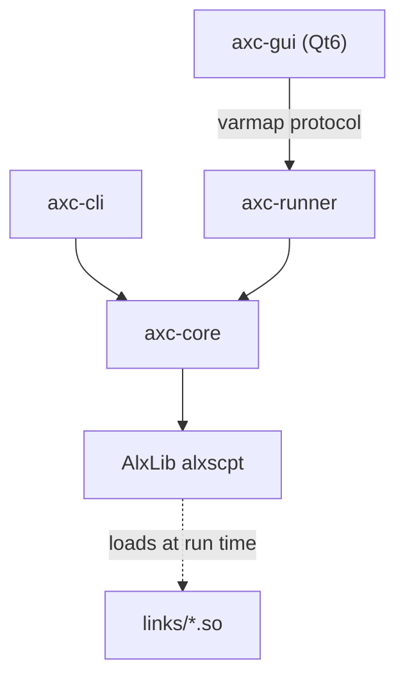
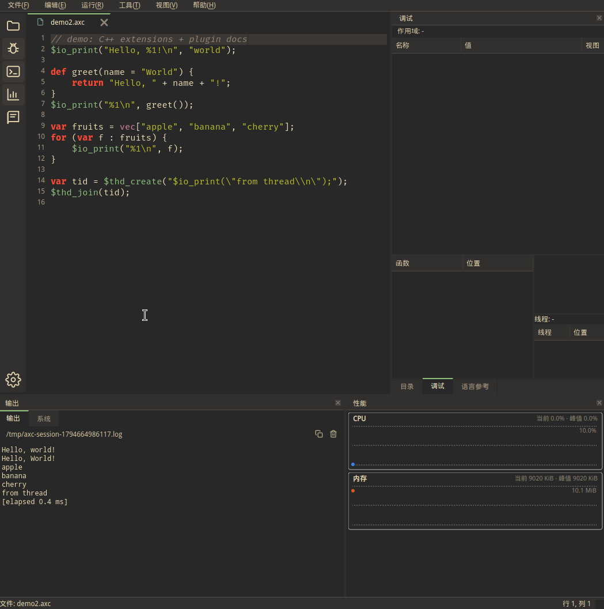

# AScript — A Lightweight C++ Scripting Language + IDE

[中文](README.md) | [English](README.en.md)

AScript is the dynamic scripting layer for a native C++ host: **C++ provides the high-performance libraries, the script orchestrates and calls them**. The language itself is Turing-complete — loops, recursion with tail-call optimisation, dynamic containers, `eval` code-level reflection — and executes on a bytecode VM; at run time it is bounded by the `engine_config` stack depth (1024 frames by default), fill count and memory limits, which the host may loosen or tighten.

The engine is a **microkernel**: the core keeps only the language itself (types and conversions, control flow, `@` reflection, `eval`, `here`, `yield`) and starts with **zero extensions** — an unregistered `$xxx` is a compile error. IO, files, system, regex and threads are all registered by the host; this project ships 15 core extension modules (compiled into `axc-core` and registered there) and 4 optional runtime `link` plugins.

It comes with a command-line tool, a Qt6 IDE and a separate runner debugging process; the script engine is provided by [AlxLib](https://github.com/AlexisVon/AlxLib)'s `alxscpt`. CLI arguments, help and diagnostics are English; the GUI and the language reference are Chinese.

## Features

- **Dynamic types** — `int` (64-bit), `float` (double), `bool`, `string`, `bytes`, `null`, plus the containers `vec`, `lst`, `map`
- **C/JS-style syntax** — `var` / `def` / `if` / `else` / `for` / `while` / `switch` / `try` / `catch` / `throw`
- **Functions** — default arguments, tail-call optimisation (TCO), argument expansion `expr[]`
- **Modules** — `import "file.axc" as alias`, with data isolated per instance
- **Native linking** — `link "lib.so" as alias` calls into a C shared library
- **Reflection** — `@` for name-level indirect access, `eval()` for code-level
- **Microkernel and two extension channels** — `engine::set_extend()` registers `$` functions (the `fwrap` native call interface); `link` loads plugins at run time over a stable ABI
- **Threads** — `$thd_create` starts an isolated engine instance, `$kv` is the shared key-value store
- **Compilation** — source compiles to bytecode (`.axp`), with self-contained `--embed`
- **Projects** — `.ax` JSON config for multi-file projects
- **Debugger** — a separate `axc-runner` process; breakpoints (line / log / conditional), pause / step / snapshot, multi-threaded sessions, variable tree and handle views

## Repository layout

```
AScript/
├── src/
│   ├── core/           # axc-core shared library: engine facade + 15 extension modules
│   │   └── impl/       # global io sys math vec lst map str regx bytes hash kv thd fs evt
│   ├── cli/            # axc-cli: run / compile / AST / REPL
│   ├── runner/         # axc-runner: one process per session, no Qt
│   ├── proto/          # the varmap protocol between GUI and runner
│   └── gui/            # axc-gui: the Qt6 Widgets IDE
├── links/              # optional link modules: cip / cv / net / ollama
├── lib/alxlib/         # vendored AlxLib headers and docs (binaries come from a release)
├── lib/opencv/         # build declaration for the optional static OpenCV
├── res/core/           # JSON / Markdown docs embedded at build time
├── res/gui/            # Qt resources: theme, icons, font
├── test/               # script and process tests, by category
├── tools/gen_res.py    # resource compiler
├── doc/                # developer docs (Chinese) and IDE screenshots
├── msvc/               # Windows project files
└── CMakeLists.txt
```

## Architecture



- `axc-cli` runs in-process: run, compile, AST dump and REPL.
- `axc-gui` never holds an engine; it starts `axc-runner` and drives execution and debugging over the `src/proto` varmap protocol.
- `links/` are optional runtime plugins, loaded by the script with `link "..." as ns;`. On Windows they sit flat in `bin\` (see below).

## Embedding and extensions

The host holds a single object, `engine`: `exec()` runs source or an `.axp`, `compile()` produces a product (version-gated, distributable without the source), `reset()` reclaims what one run left behind.

```cpp
#include "ascript.h"

using namespace alx::script;

engine* eng = engine::create();                  // no IO, no extension functions at startup
eng->set_extend("$double", [](fwrap& _f) {       // native_func = void (*)(fwrap&)
    _f.freturn(_f[0].to<double>() * 2.0);
});

engine::result rst = eng->exec("demo.axc");      // demo.axc may now call $double(21)
if (rst.error != error_type::NoError) {
    fprintf(stderr, "run failed: %s\n", error_type_name(rst.error));
}
delete eng;                                      // not a singleton: the caller deletes it
```

`fwrap` is bidirectional:

| Direction | Interface |
|-----------|-----------|
| script → C++ | `f.size()` / `f[i]` for the arguments; a bare variable name arrives as an alias of the script's variable, so writes are visible to the script |
| C++ → script | `freturn(v)` sets the result; `iload("a.b")` yields a slot address to write; `call(fn, args)` calls back into the script; `raise(info)` throws a script exception |
| C++ objects | `bind(rid, name, desc, view)` hands a C++ object to the script as an `anyptr` handle — the layout stays invisible, and the debugger renders it through `desc` / `view` |

`anyptr` comes in two holding modes, covering both lifetime demands: `anyptr_ex<T>::make()` is an **entity** (every copy on the script side clones a fresh object, so writes stay isolated), `make_ref()` is a **reference** (copies share one object, reference-counted, deleted by the last holder). A type needs one template registration (delete, clone and type id are generated), no IDL or code generation — so any C++ class can be attached as is.

Runtime plugins (`link`) use the same call interface; only the loading time differs:

```js
link "net.so" as net;                                  // the engine dlopen()s it: alexis_script_load/create/release/unload
var s = net.open("tcp_client", "127.0.0.1:39731");
```

An engine is single-threaded and not reentrant: one instance runs on one thread at a time, and `$thd_create` starts a separate engine instance.

## Quickstart

### Download

Linux x86-64 CLI package (a single executable plus the licences and third-party notices):

```bash
# Download from github.com/AlexisVon/AScript/releases and verify against the .sha256 beside it
tar -xzf ascript-1.0.0-linux-x64.tar.gz && cd ascript-1.0.0-linux-x64
./axc-cli -e '$io_print("Hello, %1!\n", "world");'
```

### Build from source

Dependencies:

| Dependency | Version |
|------------|---------|
| C++ compiler | GCC/Clang (C++17) |
| CMake | ≥ 3.19 |
| Qt 6 | ≥ 6.5 (Core, Widgets, Svg; GUI only; verified on Windows with the 6.8.3 MSVC 2022 package) |
| Python 3 | resource compilation |
| OpenCV | 4.14 (optional, `cv` link only) |

AScript links against AlxLib's shared libraries. Download the Linux shared package (`-shared`) of [AlxLib v1.5.0](https://github.com/AlexisVon/AlxLib/releases/tag/v1.5.0), verify it, and unpack it into `lib/alxlib/`:

```bash
# From the repository root; put the shared package and its .sha256 in the current directory
sha256sum -c AlxLib-1.5.0-linux-x64-*-shared.tar.gz.sha256
tar -xzf AlxLib-1.5.0-linux-x64-*-shared.tar.gz -C lib/alxlib --strip-components=1
mkdir -p bin/alxlib && cp -a lib/alxlib/bin/. bin/alxlib/

cmake -B build -DASCRIPT_OPT_LEVEL=2
cmake --build build -j7

# Smoke test: prints ok
./bin/axc-cli -e '$io_print("ok\n");'
```

Output goes to `bin/`: `axc-cli`, `axc-gui`, `axc-runner`, `libaxc-core.so`, `bin/alxlib/*.so`; with `-DBUILD_LINKS=ON` it also produces `bin/links/*.so`.

Without Qt, use `-DBUILD_GUI=OFF` to build only the CLI and the runner.

### Windows / MSVC

The Windows build uses `msvc/AScript.slnx` (Visual Studio 2022, x64):

- Install Qt VS Tools and Qt 6.8.3 MSVC 2022 64-bit (`AxcGui` needs `core;gui;widgets;svg`).
- Put the AlxLib Windows package into `lib/alxlib/` (`lib/*.lib` to link, `bin/*.dll` at run time).
- `msvc/` covers `axc-cli`, `axc-core`, `axc-gui`, `axc-runner` and the four link projects `cip`, `cv`, `net`, `ollama`; `cv` uses the Windows static OpenCV tree at `lib/opencv/win-x64/` (see `lib/opencv/README.md`).
- On Windows the link modules are output to `bin\` (`Cip.dll` / `Cv.dll` / `Net.dll` / `Ollama.dll`), with their json docs beside them.

Windows keeps AlxLib's flat layout (every DLL in `bin\`), sidestepping the platform's multi-directory DLL search; Linux keeps `bin/links/`.

### CMake options

| Option | Default | Meaning |
|--------|---------|---------|
| `BUILD_CLI` | `ON` | build `axc-cli` |
| `BUILD_GUI` | `ON` | build the Qt6 GUI |
| `BUILD_RUNNER` | `ON` | build `axc-runner` |
| `BUILD_LINKS` | `OFF` | build `links/*.so` (`cv` needs OpenCV) |
| `BUILD_REPLAY` | `OFF` | build the `axc-replay` protocol test driver |
| `BUILD_GUI_TESTS` | `OFF` | build the Qt session-layer tests |
| `CLI_STATIC` | `OFF` | link the CLI against the core sources (needs the AlxLib static package; used for the release package) |
| `ASCRIPT_OPT_LEVEL` | `2` | optimisation level (0/1/2/3) |
| `ASCRIPT_SPLIT_DEBUG` | `OFF` | split debug info into `.debug` |

### Running

Source-build artifacts carry a `$ORIGIN` rpath (`bin/` and `bin/alxlib/`), so running them in place in the repository needs no `LD_LIBRARY_PATH`; you only need one when you split `bin/` apart or copy it elsewhere:

```bash
export LD_LIBRARY_PATH=bin:bin/alxlib
```

CLI options:

| Option | Meaning |
|--------|---------|
| `<file.axc>` / `<proj.ax>` | run a script or a project (default mode) |
| `-c` | compile to `.axp` (default `<file>.axp` or the `.ax` out dir) |
| `-o <path>` | compile output path (with `-c`) |
| `--embed` | self-contained compile: inline every import (with `-c`) |
| `-x` | execute source or an `.axp` |
| `-j` | print the AST |
| `-f` / `--fmt` | format source |
| `-e <code>` | execute inline code (also with `-c` / `-j`) |
| `-i` | interactive REPL |
| `-p <dir>` | append an import search path (repeatable) |
| `--ret` | print the script's return value |
| `-v` | version (`axc-1.0.0`) |
| `--doc [regex]` | print the extension manual (regex filters function names) |
| `--toc [regex]` | list extension function names only |
| `--lang [regex]` | print the embedded language reference (regex filters chapters) |
| `--overflow-check` | enable integer overflow checks |
| `--max-stack N` | maximum stack depth (0 = unlimited) |
| `--max-vecfill N` | fill limit per statement |
| `--debug` / `--no-debug` | record / skip statement positions (affects trace line numbers) |
| `--hook` / `--no-hook` | enable / disable trap breakpoint printing |

```bash
./bin/axc-cli script.axc                       # run
./bin/axc-cli -c script.axc                    # compile to .axp
./bin/axc-cli -x script.axp                    # execute bytecode
./bin/axc-cli -j script.axc                    # print the AST
./bin/axc-cli -e 'return 1 + 2;' --ret         # print the script's return value
./bin/axc-cli -i                               # REPL
./bin/axc-cli --doc str_                       # extension manual
./bin/axc-cli --lang                           # language reference
```

Project file `myproject.ax`:

```json
{ "name": "myproject", "main": "main.axc", "path": ["lib"] }
```

Relative paths resolve against the directory of the `.ax`:

| Key | Meaning |
|-----|---------|
| `main` | required, the entry script |
| `name` | display name, defaults to the `.ax` file name |
| `out` | compile output dir (empty = ask each time) |
| `path` | `import` / `link` search paths |
| `docpath` | hint-only dirs for IDE completion |
| `hint` | hint JSON file |
| `engine` | engine settings object (CLI flags override it) |
| `hook` / `hook_freq` | debug hook switch and frequency |

```bash
./bin/axc-cli myproject.ax
```

GUI:

```bash
./bin/axc-gui
./bin/axc-gui script.axc
./bin/axc-gui myproject.ax
```



### Language example

```js
$io_print("What is your name? ");
var name = $io_input();
$io_print("Hello, %1!\n", name);

def greet(name = "World") {
    return "Hello, " + name + "!";
}

var fruits = vec["apple", "banana", "cherry"];
for (var f : fruits) {
    $io_print("%1\n", f);
}

$io_print("sqrt(144) = %1\n", $math_sqrt(144));

var tid = $thd_create("$io_print(\"Hello from thread!\\n\");");
$thd_join(tid);

try {
    var x = int("not_a_number");   // int() is a built-in conversion; non-numeric throws
} catch (e) {
    $io_print("Error: %1\n", e);
}
```

A few of the less common constructs:

```js
// $ prefix: host-registered extension functions, kept out of the script's own namespace
$io_print("sqrt(144) = %1\n", $math_sqrt(144));

// expr[] spreads a container into arguments; allowed only in the last position
def add3(a, b, c) { return a + b + c; }
$io_print("%1\n", add3([1, 2, 3][]));            // vec spreads in order
$io_print("%1\n", add3(map{"c": 3, "a": 1, "b": 2}[]));   // map matches by parameter name

// @ reflection: a function name is just a string, so call it by name
def add(a, b) { return a + b; }
def mul(a, b) { return a * b; }
var ops = map{"+": "add", "*": "mul"};
var op = ops["*"];
$io_print("%1\n", @op(3, 4));                    // 12
```

### Tests

```bash
bash test/cli/test.sh          # CLI / language / containers / threads (builds its own test modules)
bash test/runner/run.sh        # needs cmake -B build -DBUILD_REPLAY=ON && cmake --build build -j7
bash test/gui/run.sh           # needs cmake -B build -DBUILD_GUI_TESTS=ON && cmake --build build -j7
bash test/cli/libpaths/run.sh  # {script} and an axp's search_paths
bash test/cli/cip/run.sh       # EtherNet/IP, no hardware needed
bash test/cli/net/run.sh       # raw TCP/UDP, no hardware needed
bash test/cli/cv/run.sh        # needs -DBUILD_LINKS=ON and OpenCV
```

### Documentation

- Language reference: [`res/core/lang.md`](res/core/lang.md) (Chinese, embedded at build time; `./bin/axc-cli --lang` prints it, `--lang <regex>` filters chapters)
- Extension manual: `./bin/axc-cli --doc [regex]`; `--toc` lists names only
- Library paths and axp search paths: [`doc/library-paths.md`](doc/library-paths.md)
- Debugger handle-view protocol: [`doc/view-protocol.md`](doc/view-protocol.md)

### Security boundary

AScript is a development tool, not a sandbox. A script can reach the host machine, the filesystem and the network through `$sys_exec`, `$fs_*` and `link` modules. To confine untrusted code, use [AlxRun](https://github.com/AlexisVon/AlxRun).

### Related projects

- [AlxLib](https://github.com/AlexisVon/AlxLib) — the underlying C++ library and the `alxscpt` script engine
- [AlxRun](https://github.com/AlexisVon/AlxRun) — a restricted MCP runner for the same language (no shell, no network, no subprocesses)

## License

MIT License. Copyright (c) 2026 AlexisVon.

Third-party components and full licence texts are in [THIRD-PARTY.md](THIRD-PARTY.md) and [`licenses/`](licenses/); AlxLib keeps its own list in `lib/alxlib/THIRD-PARTY.md`.
Read [CONTRIBUTING.md](CONTRIBUTING.md) and sign the DCO before contributing.
