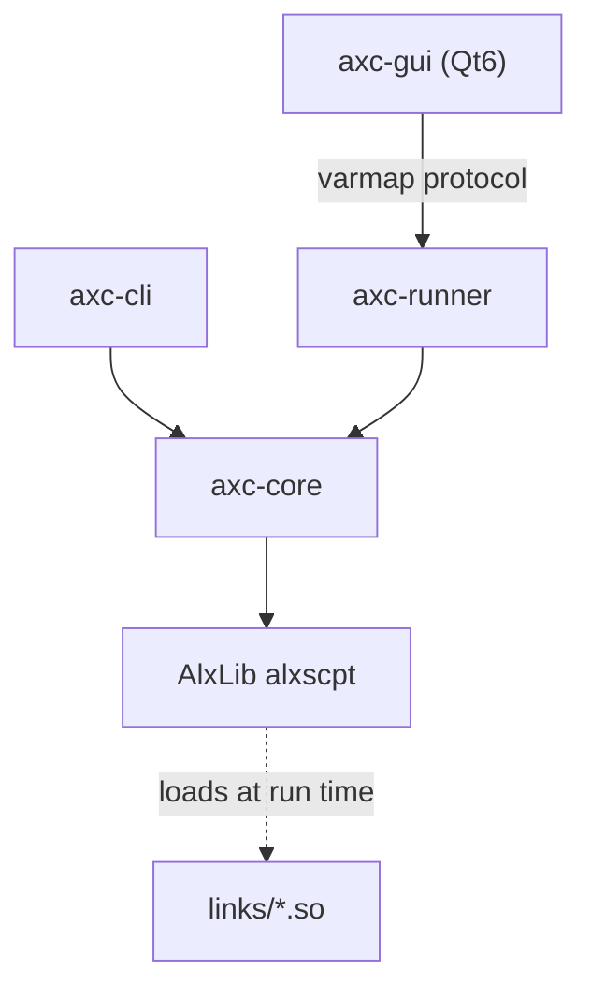

# AScript — A Lightweight C++ Scripting Language + IDE

[中文](README.md) | [English](README.en.md)

AScript is a lightweight scripting language written in C++17, with a command-line tool, a Qt6 IDE, and a separate runner process. Its engine is `alxscpt` from [AlxLib](https://github.com/AlexisVon/AlxLib).

## Features

- **Dynamic types** — `int` (64-bit), `float` (double), `bool`, `string`, `bytes`, `null`, plus the containers `vec`, `lst`, and `map`
- **C/JS-style syntax** — `var` / `def` / `if` / `else` / `for` / `while` / `switch` / `try` / `catch` / `throw`
- **Functions** — default parameters, tail-call optimization (TCO), argument unpacking `expr[]`
- **Modules** — `import "file.axc" as alias` with per-instance data isolation
- **Native linking** — `link "lib.so" as alias` calls a C shared library directly
- **Reflection** — `@` for name-level indirection, `eval()` for code-level reflection
- **Threads** — `$thd_create` runs an isolated engine instance, `$kv` shares a key-value store
- **Compilation** — source compiles to bytecode (`.axp`), with self-contained embedding via `--embed`
- **Projects** — `.ax` JSON configuration files manage multi-file projects
- **Debugger** — a separate `axc-runner` process; line/log/conditional breakpoints, pause/step/snapshot, multi-thread sessions, variable trees, and handle views

## Repository layout

```
AScript/
├── src/
│   ├── core/           # axc-core shared library: engine facade + 15 extension modules
│   │   └── impl/       # global io sys math vec lst map str regx bytes hash kv thd fs evt
│   ├── cli/            # axc-cli: run / compile / AST / REPL
│   ├── runner/         # axc-runner: one process per session, no Qt
│   ├── proto/          # varmap protocol between the GUI and the runner
│   └── gui/            # axc-gui: Qt6 Widgets IDE
├── links/              # optional link modules: cip / cv / net / ollama
├── lib/alxlib/         # vendored AlxLib headers and docs (binaries come from a release)
├── lib/opencv/         # build declaration for the optional static OpenCV
├── res/core/           # JSON / Markdown docs embedded at compile time
├── res/gui/            # Qt resources: theme, icons, font
├── test/               # script and process tests by category
├── tools/gen_res.py    # resource compiler
├── doc/                # developer documentation (Chinese)
├── msvc/               # Windows project files
└── CMakeLists.txt
```

## Architecture



- `axc-cli` runs in-process: execution, compilation, AST dumps, and the REPL.
- `axc-gui` does not own an engine; it starts `axc-runner` and drives execution and debugging over the varmap protocol in `src/proto`.
- `links/` are optional `.so` extensions loaded by scripts with `link "..." as ns;`.

## Quickstart

### Download

The Linux x86-64 CLI package (a single executable plus license and third-party notices):

```bash
# Download from github.com/AlexisVon/AScript/releases and verify against the .sha256 beside it
tar -xzf ascript-1.0.0-linux-x64.tar.gz && cd ascript-1.0.0-linux-x64
./axc-cli -e '$io_print("Hello, %1!\n", "world");'
```

### Build from source

Dependencies:

| Dependency | Version |
|------------|---------|
| C++ compiler | GCC/Clang (C++17) |
| CMake | ≥ 3.19 |
| Qt 6 | ≥ 6.5 (Core, Widgets, Svg; GUI only) |
| Python 3 | resource generation |
| OpenCV | 4.14 (optional, `cv` link only) |

AScript links against AlxLib's shared libraries. Download the Linux shared-library package (`-shared`) from [AlxLib v1.5.0](https://github.com/AlexisVon/AlxLib/releases/tag/v1.5.0), verify it, and unpack it into `lib/alxlib/`:

```bash
# From the repository root; put the shared package and its .sha256 in the current directory
sha256sum -c AlxLib-1.5.0-linux-x64-*-shared.tar.gz.sha256
tar -xzf AlxLib-1.5.0-linux-x64-*-shared.tar.gz -C lib/alxlib --strip-components=1
mkdir -p bin/alxlib && cp -a lib/alxlib/bin/. bin/alxlib/

cmake -B build -DASCRIPT_OPT_LEVEL=2
cmake --build build -j7
```

Outputs land in `bin/`: `axc-cli`, `axc-gui`, `axc-runner`, `libaxc-core.so`, and `bin/alxlib/*.so`; `-DBUILD_LINKS=ON` also produces `bin/links/*.so`.

Without Qt, use `-DBUILD_GUI=OFF` to build only the CLI and the runner.

### Windows / MSVC

Windows builds use `msvc/AScript.slnx` (Visual Studio 2022, x64):

- Install Qt VS Tools and Qt 6.8.3 MSVC 2022 64-bit (`AxcGui` needs `core;gui;widgets;svg`).
- Put the AlxLib Windows package under `lib/alxlib/` (`lib/*.lib` for linking, `bin/*.dll` at run time).
- `msvc/` contains `axc-cli`, `axc-core`, `axc-gui`, `axc-runner`, and the `cip`, `cv`, `net`, and `ollama` link projects; `cv` uses the Windows OpenCV static tree at `lib/opencv/win-x64/` (see `lib/opencv/README.md`).
- On Windows, link modules are built into `bin\` (`Cip.dll` / `Cv.dll` / `Net.dll` / `Ollama.dll`), with their JSON docs beside them.

Windows follows AlxLib's flat layout (all DLLs in `bin\`), avoiding the platform differences in DLL search paths; Linux keeps `bin/links/`.

### CMake options

| Option | Default | Meaning |
|--------|---------|---------|
| `BUILD_CLI` | `ON` | build `axc-cli` |
| `BUILD_GUI` | `ON` | build the Qt6 GUI |
| `BUILD_RUNNER` | `ON` | build `axc-runner` |
| `BUILD_LINKS` | `OFF` | build `links/*.so` (`cv` needs OpenCV) |
| `BUILD_REPLAY` | `OFF` | build the `axc-replay` protocol test driver |
| `BUILD_GUI_TESTS` | `OFF` | build the Qt session-layer tests |
| `CLI_STATIC` | `OFF` | link the CLI against the core sources statically (needs the AlxLib static package) |
| `ASCRIPT_OPT_LEVEL` | `2` | optimization level (0/1/2/3) |
| `ASCRIPT_SPLIT_DEBUG` | `OFF` | split debug info into `.debug` files |

### Running

A source-built `axc-cli` links `axc-core` and AlxLib dynamically; put the library directories on the search path first (the static CLI in the release package does not need this):

```bash
export LD_LIBRARY_PATH=bin:bin/alxlib
```

```bash
./bin/axc-cli -v                  # version (axc-1.0.0)
./bin/axc-cli script.axc          # run
./bin/axc-cli -c script.axc       # compile to .axp
./bin/axc-cli -x script.axp       # execute bytecode
./bin/axc-cli -j script.axc       # print the AST
./bin/axc-cli -e 'return 1 + 2;' --ret
./bin/axc-cli -i                  # REPL
./bin/axc-cli --doc str_          # extension-function manual
./bin/axc-cli --lang              # language reference
```

Project file `myproject.ax`:

```json
{ "name": "myproject", "main": "main.axc", "files": ["lib.axc", "utils.axc"] }
```

```bash
./bin/axc-cli myproject.ax
```

GUI:

```bash
./bin/axc-gui
./bin/axc-gui script.axc
./bin/axc-gui myproject.ax
```

### Language example

```js
$io_print("What is your name? ");
var name = $io_input();
$io_print("Hello, %1!\n", name);

def greet(name = "World") {
    return "Hello, " + name + "!";
}

var fruits = vec["apple", "banana", "cherry"];
for (var f : fruits) {
    $io_print("%1\n", f);
}

var result = $math_sqrt(144);

var tid = $thd_create("$io_print(\"Hello from thread!\\n\");");
$thd_join(tid);

try {
    var x = int("not_a_number");
} catch (e) {
    $io_print("Error: %1\n", e);
}
```

### Tests

```bash
(cd test/cli && make && bash test.sh)   # CLI / language / containers / threads
bash test/runner/run.sh                 # needs -DBUILD_REPLAY=ON
bash test/gui/run.sh                    # needs -DBUILD_GUI_TESTS=ON
bash test/cli/libpaths/run.sh
bash test/cli/cip/run.sh
bash test/cli/net/run.sh
bash test/cli/cv/run.sh                 # needs OpenCV
```

### Documentation

- Language reference: [`res/core/lang.md`](res/core/lang.md) (Chinese, embedded at compile time)
- Library paths and axp search paths: [`doc/library-paths.md`](doc/library-paths.md)
- Debugger handle view protocol: [`doc/view-protocol.md`](doc/view-protocol.md)

CLI arguments, help, and error messages are in English; the GUI and the language reference are in Chinese.

### Security boundary

AScript is a development tool, not a sandbox. Scripts can reach the host, the filesystem, and the network through `$sys_exec`, `$fs_*`, and `link` modules. To confine untrusted code, use [AlxRun](https://github.com/AlexisVon/AlxRun).

### Related projects

- [AlxLib](https://github.com/AlexisVon/AlxLib) — the underlying C++ library and the `alxscpt` engine
- [AlxRun](https://github.com/AlexisVon/AlxRun) — a restricted MCP runner for the same language (no shell, no network, no subprocesses)

## License

MIT License. Copyright (c) 2026 AlexisVon.

Third-party components and full license texts: see [THIRD-PARTY.md](THIRD-PARTY.md) and [`licenses/`](licenses/); AlxLib's own manifest is `lib/alxlib/THIRD-PARTY.md`.
Read [CONTRIBUTING.md](CONTRIBUTING.md) and sign the DCO before contributing.
