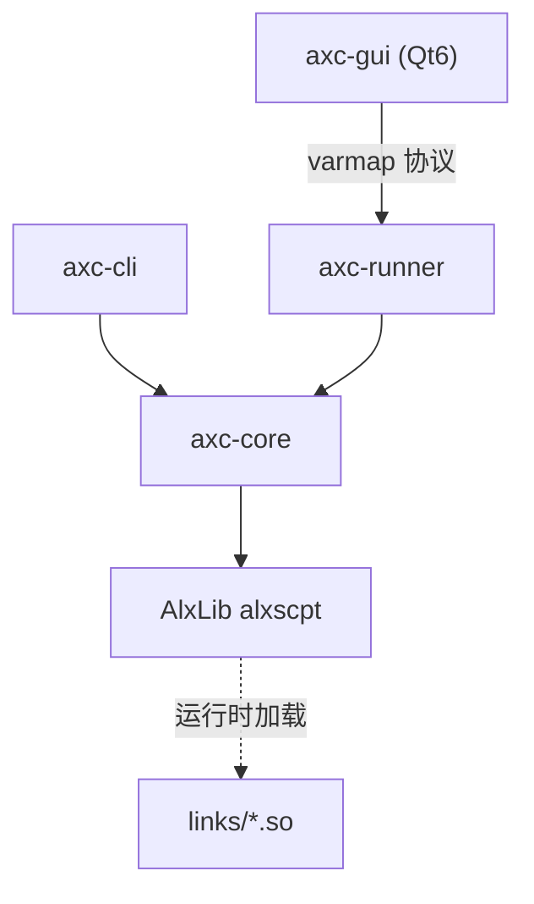
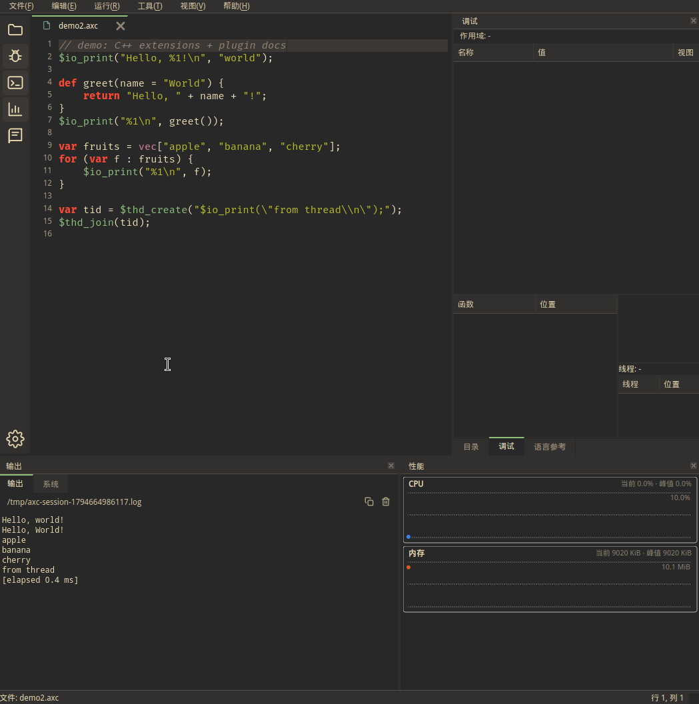

# AScript — 轻量 C++ 脚本语言 + IDE

[中文](README.md) | [English](README.en.md)

AScript 是给原生 C++ 宿主的动态脚本层：**C++ 写高性能函数库，脚本在上层编排调用**。语言本身是图灵完备的——循环、递归（含尾调用优化）、动态容器、`eval` 代码级反射——执行在字节码 VM 上；运行时受 `engine_config` 的栈深（默认 1024 帧）、填充量与内存上界约束，宿主可按需放宽或收紧。

引擎是**微内核**的：内核只保留语言本身（类型与转换、控制流、`@` 反射、`eval`、`here`、`yield`），**零扩展**起步——`$xxx` 没注册就是编译错误。IO、文件、系统、正则、线程这些能力全部由宿主注册；本项目随附 15 个核心扩展模块（编译进 `axc-core` 后注册）与 4 个可选的运行时 `link` 插件。

自带命令行工具、Qt6 图形 IDE 与独立 runner 调试进程；脚本引擎由 [AlxLib](https://github.com/AlexisVon/AlxLib) 的 `alxscpt` 提供。CLI 的参数、帮助与错误信息为英文，GUI 与语言参考为中文。

## 特性

- **动态类型** — `int`（64 位）、`float`（double）、`bool`、`string`、`bytes`、`null`，以及容器 `vec`、`lst`、`map`
- **C/JS 风格语法** — `var` / `def` / `if` / `else` / `for` / `while` / `switch` / `try` / `catch` / `throw`
- **函数** — 默认参数、尾调用优化（TCO）、参数解包 `expr[]`
- **模块系统** — `import "file.axc" as alias`，实例间数据隔离
- **原生链接** — `link "lib.so" as alias`，直接调用 C 共享库
- **反射** — `@` 名称级间接引用，`eval()` 代码级反射
- **微内核与双通道扩展** — `engine::set_extend()` 注册 `$` 函数（`fwrap` 原生调用接口）；`link` 运行时加载插件，ABI 稳定
- **多线程** — `$thd_create` 创建隔离引擎实例，`$kv` 共享键值存储
- **编译** — 源码编译为字节码（`.axp`），支持自包含嵌入 `--embed`
- **项目系统** — `.ax` JSON 配置文件，管理多文件项目
- **调试器** — 独立 `axc-runner` 进程；断点（行 / 日志 / 条件）、暂停 / 单步 / 快照、多线程会话、变量树与 handle 视图

## 项目结构

```
AScript/
├── src/
│   ├── core/           # axc-core 共享库：引擎门面 + 15 个扩展模块
│   │   └── impl/       # global io sys math vec lst map str regx bytes hash kv thd fs evt
│   ├── cli/            # axc-cli：运行 / 编译 / AST / REPL
│   ├── runner/         # axc-runner：一次会话一个进程，无 Qt
│   ├── proto/          # GUI ↔ runner 的 varmap 协议
│   └── gui/            # axc-gui：Qt6 Widgets IDE
├── links/              # 可选 link 模块：cip / cv / net / ollama
├── lib/alxlib/         # vendored AlxLib 头文件与文档（二进制从 release 取）
├── lib/opencv/         # 可选静态 OpenCV 的构建声明
├── res/core/           # 编译期嵌入的 JSON / Markdown 文档
├── res/gui/            # Qt 资源：主题、图标、字体
├── test/               # 按类别组织的脚本与进程测试
├── tools/gen_res.py    # 资源编译器
├── doc/                # 开发者文档（中文）与 IDE 截图
├── msvc/               # Windows 工程文件
└── CMakeLists.txt
```

## 架构



- `axc-cli` 在进程内执行：运行、编译、AST 导出与 REPL。
- `axc-gui` 不直接持有引擎；它启动 `axc-runner`，通过 `src/proto` 的 varmap 协议驱动执行与调试。
- `links/` 是可选的运行时插件，由脚本用 `link "..." as ns;` 加载；Windows 下平铺在 `bin\`（见下文）。

## 嵌入与扩展

宿主只持有 `engine` 一个对象：`exec()` 跑源码或 `.axp`，`compile()` 出产物（带版本校验，可脱离源码分发），`reset()` 回收一次运行的残留状态。

```cpp
#include "ascript.h"

using namespace alx::script;

engine* eng = engine::create();                  // 内核启动时没有任何 IO、没有任何扩展
eng->set_extend("$double", [](fwrap& _f) {       // native_func = void (*)(fwrap&)
    _f.freturn(_f[0].to<double>() * 2.0);
});

engine::result rst = eng->exec("demo.axc");      // demo.axc 里可以直接写 $double(21)
if (rst.error != error_type::NoError) {
    fprintf(stderr, "run failed: %s\n", error_type_name(rst.error));
}
delete eng;                                      // 非单例，调用方负责销毁
```

`fwrap` 是双向的：

| 方向 | 接口 |
|------|------|
| 脚本 → C++ | `f.size()` / `f[i]` 取参；裸变量名作实参时是脚本变量的别名，写回脚本可见 |
| C++ → 脚本 | `freturn(v)` 回值；`iload("a.b")` 取槽地址直接写；`call(fn, args)` 回调脚本函数；`raise(info)` 抛脚本异常 |
| C++ 对象 | `bind(rid, name, desc, view)` 以 `anyptr` 句柄交给脚本，布局对脚本不可见，调试器按 `desc` / `view` 渲染 |

`anyptr` 有两种持有模式，覆盖对象生命周期的两类诉求：`anyptr_ex<T>::make()` 是**实体**（脚本侧每次复制都克隆出新对象，写时自然隔离），`make_ref()` 是**引用**（复制共享同一对象，引用计数，最后一个持有者析构）。类型只需一次模板注册（删除、克隆与类型标识自动生成），不需要 IDL 或代码生成，所以任意 C++ 类都能直接挂上来。

运行时插件（`link`）走同一套调用接口，区别只在加载时机：

```js
link "net.so" as net;                                  // 引擎 dlopen：alexis_script_load/create/release/unload
var s = net.open("tcp_client", "127.0.0.1:39731");
```

引擎单线程、不重入：一个实例一次跑在一个线程上，`$thd_create` 起的是独立的引擎实例。

## 快速开始

### 下载

Linux x86-64 CLI 包（单个可执行文件 + 许可证与第三方声明）：

```bash
# 从 github.com/AlexisVon/AScript/releases 下载，并用同目录的 .sha256 校验
tar -xzf ascript-1.0.0-linux-x64.tar.gz && cd ascript-1.0.0-linux-x64
./axc-cli -e '$io_print("Hello, %1!\n", "world");'
```

### 从源码构建

依赖：

| 依赖 | 版本 |
|------|------|
| C++ 编译器 | GCC/Clang（C++17） |
| CMake | ≥ 3.19 |
| Qt 6 | ≥ 6.5（Core, Widgets, Svg；仅 GUI；Windows 用 6.8.3 MSVC 2022 包验证） |
| Python 3 | 资源编译 |
| OpenCV | 4.14（可选，仅 `cv` link） |

AScript 链接 AlxLib 的共享库。先从 [AlxLib v1.5.0](https://github.com/AlexisVon/AlxLib/releases/tag/v1.5.0) 下载 Linux 共享库包（`-shared`），校验后解包到 `lib/alxlib/`：

```bash
# 在仓库根目录，把共享库包与 .sha256 放到当前目录
sha256sum -c AlxLib-1.5.0-linux-x64-*-shared.tar.gz.sha256
tar -xzf AlxLib-1.5.0-linux-x64-*-shared.tar.gz -C lib/alxlib --strip-components=1
mkdir -p bin/alxlib && cp -a lib/alxlib/bin/. bin/alxlib/

cmake -B build -DASCRIPT_OPT_LEVEL=2
cmake --build build -j7

# 冒烟：应打印 ok
./bin/axc-cli -e '$io_print("ok\n");'
```

产物在 `bin/`：`axc-cli`、`axc-gui`、`axc-runner`、`libaxc-core.so`、`bin/alxlib/*.so`；加 `-DBUILD_LINKS=ON` 还会生成 `bin/links/*.so`。

没有 Qt 时用 `-DBUILD_GUI=OFF` 只构建 CLI 与 runner。

### Windows / MSVC

Windows 构建使用 `msvc/AScript.slnx`（Visual Studio 2022，x64）：

- 安装 Qt VS Tools 与 Qt 6.8.3 MSVC 2022 64-bit（`AxcGui` 需要 `core;gui;widgets;svg`）。
- 把 AlxLib 的 Windows 发行包放到 `lib/alxlib/`（`lib/*.lib` 供链接，`bin/*.dll` 随程序运行）。
- `msvc/` 包含 `axc-cli`、`axc-core`、`axc-gui`、`axc-runner` 与 `cip`、`cv`、`net`、`ollama` 四个 link 工程；`cv` 使用 Windows OpenCV 静态树 `lib/opencv/win-x64/`（见 `lib/opencv/README.md`）。
- Windows 下 link 模块输出到 `bin\`（`Cip.dll` / `Cv.dll` / `Net.dll` / `Ollama.dll`），json 文档同目录。

Windows 沿用 AlxLib 的平铺布局（所有 DLL 在 `bin\`），避开多目录 DLL 搜索路径的平台差异；Linux 保持 `bin/links/`。

### CMake 选项

| 选项 | 默认 | 说明 |
|------|------|------|
| `BUILD_CLI` | `ON` | 构建 `axc-cli` |
| `BUILD_GUI` | `ON` | 构建 Qt6 GUI |
| `BUILD_RUNNER` | `ON` | 构建 `axc-runner` |
| `BUILD_LINKS` | `OFF` | 构建 `links/*.so`（`cv` 需要 OpenCV） |
| `BUILD_REPLAY` | `OFF` | 构建 `axc-replay` 协议测试驱动 |
| `BUILD_GUI_TESTS` | `OFF` | 构建 Qt session 层测试 |
| `CLI_STATIC` | `OFF` | CLI 静态链接核心源码（需要 AlxLib 静态包；发布包用这一档） |
| `ASCRIPT_OPT_LEVEL` | `2` | 优化级别（0/1/2/3） |
| `ASCRIPT_SPLIT_DEBUG` | `OFF` | 调试信息分离到 `.debug` |

### 运行

源码构建的产物自带 `$ORIGIN` rpath（`bin/` 与 `bin/alxlib/`），在仓库里原位运行不需要设 `LD_LIBRARY_PATH`；只有把 `bin/` 拆开或复制到别处时才需要：

```bash
export LD_LIBRARY_PATH=bin:bin/alxlib
```

CLI 选项：

| 选项 | 说明 |
|------|------|
| `<file.axc>` / `<proj.ax>` | 运行脚本或项目（默认模式） |
| `-c` | 编译为 `.axp`（默认输出 `<file>.axp` 或 `.ax` 的 out 目录） |
| `-o <path>` | 编译输出路径（配合 `-c`） |
| `--embed` | 自包含编译：内联全部 import（配合 `-c`） |
| `-x` | 执行源码或 `.axp` |
| `-j` | 打印 AST |
| `-f` / `--fmt` | 格式化源码 |
| `-e <code>` | 执行内联代码（也配合 `-c` / `-j`） |
| `-i` | 交互式 REPL |
| `-p <dir>` | 追加 import 搜索路径（可重复） |
| `--ret` | 打印脚本的返回值 |
| `-v` | 版本（`axc-1.0.0`） |
| `--doc [regex]` | 打印扩展函数手册（正则过滤函数名） |
| `--toc [regex]` | 只列扩展函数名 |
| `--lang [regex]` | 打印内嵌的语言参考（正则过滤章节） |
| `--overflow-check` | 开启整数溢出检测 |
| `--max-stack N` | 最大栈深（0 = 不限） |
| `--max-vecfill N` | 单条语句的填充上限 |
| `--debug` / `--no-debug` | 记录 / 不记录语句位置（影响 trace 行号） |
| `--hook` / `--no-hook` | 开启 / 关闭 trap 断点打印 |

```bash
./bin/axc-cli script.axc                       # 运行
./bin/axc-cli -c script.axc                    # 编译为 .axp
./bin/axc-cli -x script.axp                    # 执行字节码
./bin/axc-cli -j script.axc                    # 打印 AST
./bin/axc-cli -e 'return 1 + 2;' --ret         # 打印脚本返回值
./bin/axc-cli -i                               # REPL
./bin/axc-cli --doc str_                       # 扩展函数手册
./bin/axc-cli --lang                           # 语言参考
```

项目文件 `myproject.ax`：

```json
{ "name": "myproject", "main": "main.axc", "path": ["lib"] }
```

相对路径按 `.ax` 所在目录解析：

| 键 | 说明 |
|----|------|
| `main` | 必需，起始脚本 |
| `name` | 显示名，缺省用 `.ax` 文件名 |
| `out` | 编译输出目录（空 = 每次选择） |
| `path` | `import` / `link` 搜索路径数组 |
| `docpath` | 仅 IDE 补全用的提示目录 |
| `hint` | hint JSON 文件 |
| `engine` | 引擎参数对象（CLI 参数可覆盖） |
| `hook` / `hook_freq` | 调试 hook 开关与频率 |

```bash
./bin/axc-cli myproject.ax
```

GUI：

```bash
./bin/axc-gui
./bin/axc-gui script.axc
./bin/axc-gui myproject.ax
```



### 语言示例

```js
$io_print("What is your name? ");
var name = $io_input();
$io_print("Hello, %1!\n", name);

def greet(name = "World") {
    return "Hello, " + name + "!";
}

var fruits = vec["apple", "banana", "cherry"];
for (var f : fruits) {
    $io_print("%1\n", f);
}

$io_print("sqrt(144) = %1\n", $math_sqrt(144));

var tid = $thd_create("$io_print(\"Hello from thread!\\n\");");
$thd_join(tid);

try {
    var x = int("not_a_number");   // int() 是内置转换函数，非数字抛异常
} catch (e) {
    $io_print("Error: %1\n", e);
}
```

几个不常见的语法：

```js
// $ 前缀：宿主注册的扩展函数，与脚本自己的名字空间隔离
$io_print("sqrt(144) = %1\n", $math_sqrt(144));

// expr[]：把容器摊开成实参，只允许出现在最后一个实参位置
def add3(a, b, c) { return a + b + c; }
$io_print("%1\n", add3([1, 2, 3][]));            // vec 按序展开
$io_print("%1\n", add3(map{"c": 3, "a": 1, "b": 2}[]));   // map 按参数名匹配

// @ 反射：函数名就是字符串，按名调用
def add(a, b) { return a + b; }
def mul(a, b) { return a * b; }
var ops = map{"+": "add", "*": "mul"};
var op = ops["*"];
$io_print("%1\n", @op(3, 4));                    // 12
```

### 测试

```bash
bash test/cli/test.sh          # CLI / 语言 / 容器 / 线程（脚本内自己 make 测试模块）
bash test/runner/run.sh        # 需要 cmake -B build -DBUILD_REPLAY=ON && cmake --build build -j7
bash test/gui/run.sh           # 需要 cmake -B build -DBUILD_GUI_TESTS=ON && cmake --build build -j7
bash test/cli/libpaths/run.sh  # {script} 与 axp 的 search_paths
bash test/cli/cip/run.sh       # EtherNet/IP，无需硬件
bash test/cli/net/run.sh       # 原始 TCP/UDP，无需硬件
bash test/cli/cv/run.sh        # 需要 -DBUILD_LINKS=ON 与 OpenCV
```

### 文档

- 语言参考：[`res/core/lang.md`](res/core/lang.md)（中文，编译期内嵌；`./bin/axc-cli --lang` 打印，`--lang <regex>` 过滤章节）
- 扩展函数手册：`./bin/axc-cli --doc [regex]`，`--toc` 只列名字
- 库路径与 axp 搜索路径：[`doc/library-paths.md`](doc/library-paths.md)
- 调试器 handle 视图协议：[`doc/view-protocol.md`](doc/view-protocol.md)

### 安全边界

AScript 是开发工具，不是沙箱。脚本可以经 `$sys_exec`、`$fs_*` 与 `link` 模块访问宿主机、文件系统与网络。需要把不可信代码关进受限环境时，使用 [AlxRun](https://github.com/AlexisVon/AlxRun)。

### 相关项目

- [AlxLib](https://github.com/AlexisVon/AlxLib) — 底层 C++ 库与 `alxscpt` 脚本引擎
- [AlxRun](https://github.com/AlexisVon/AlxRun) — 同一语言的受限 MCP runner（无 shell、无网络、无子进程）

## 许可

MIT License. Copyright (c) 2026 AlexisVon.

第三方组件与许可全文见 [THIRD-PARTY.md](THIRD-PARTY.md) 与 [`licenses/`](licenses/)；AlxLib 自己的清单在 `lib/alxlib/THIRD-PARTY.md`。
贡献前请读 [CONTRIBUTING.md](CONTRIBUTING.md) 并签 DCO。
