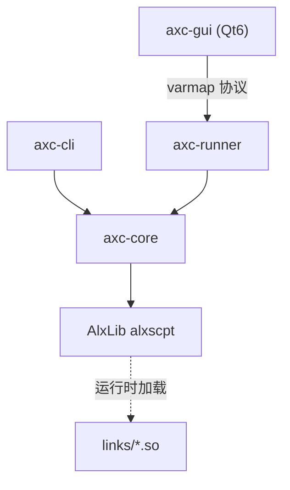

# AScript — 轻量 C++ 脚本语言 + IDE

[中文](README.md) | [English](README.en.md)

AScript 是一个用 C++17 编写的轻量级脚本语言，自带命令行工具、Qt6 图形 IDE 与独立 runner 进程；脚本引擎由 [AlxLib](https://github.com/AlexisVon/AlxLib) 的 `alxscpt` 提供。

## 特性

- **动态类型** — `int`（64 位）、`float`（double）、`bool`、`string`、`bytes`、`null`，以及容器 `vec`、`lst`、`map`
- **C/JS 风格语法** — `var` / `def` / `if` / `else` / `for` / `while` / `switch` / `try` / `catch` / `throw`
- **函数** — 默认参数、尾调用优化（TCO）、参数解包 `expr[]`
- **模块系统** — `import "file.axc" as alias`，实例间数据隔离
- **原生链接** — `link "lib.so" as alias`，直接调用 C 共享库
- **反射** — `@` 名称级间接引用，`eval()` 代码级反射
- **多线程** — `$thd_create` 创建隔离引擎实例，`$kv` 共享键值存储
- **编译** — 源码编译为字节码（`.axp`），支持自包含嵌入 `--embed`
- **项目系统** — `.ax` JSON 配置文件，管理多文件项目
- **调试器** — 独立 `axc-runner` 进程；断点（行 / 日志 / 条件）、暂停 / 单步 / 快照、多线程会话、变量树与 handle 视图

## 项目结构

```
AScript/
├── src/
│   ├── core/           # axc-core 共享库：引擎门面 + 15 个扩展模块
│   │   └── impl/       # global io sys math vec lst map str regx bytes hash kv thd fs evt
│   ├── cli/            # axc-cli：运行 / 编译 / AST / REPL
│   ├── runner/         # axc-runner：一次会话一个进程，无 Qt
│   ├── proto/          # GUI ↔ runner 的 varmap 协议
│   └── gui/            # axc-gui：Qt6 Widgets IDE
├── links/              # 可选 link 模块：cip / cv / net / ollama
├── lib/alxlib/         # vendored AlxLib 头文件与文档（二进制从 release 取）
├── lib/opencv/         # 可选静态 OpenCV 的构建声明
├── res/core/           # 编译期嵌入的 JSON / Markdown 文档
├── res/gui/            # Qt 资源：主题、图标、字体
├── test/               # 按类别组织的脚本与进程测试
├── tools/gen_res.py    # 资源编译器
├── doc/                # 开发者文档（中文）
├── msvc/               # Windows 工程文件
└── CMakeLists.txt
```

## 架构



- `axc-cli` 在进程内执行：运行、编译、AST 导出与 REPL。
- `axc-gui` 不直接持有引擎；它启动 `axc-runner`，通过 `src/proto` 的 varmap 协议驱动执行与调试。
- `links/` 是可选的 `.so` 扩展，由脚本用 `link "..." as ns;` 加载。

## 快速开始

### 下载

Linux x86-64 CLI 包（单个可执行文件 + 许可证与第三方声明）：

```bash
# 从 github.com/AlexisVon/AScript/releases 下载，并用同目录的 .sha256 校验
tar -xzf ascript-1.0.0-linux-x64.tar.gz && cd ascript-1.0.0-linux-x64
./axc-cli -e '$io_print("Hello, %1!\n", "world");'
```

### 从源码构建

依赖：

| 依赖 | 版本 |
|------|------|
| C++ 编译器 | GCC/Clang（C++17） |
| CMake | ≥ 3.19 |
| Qt 6 | ≥ 6.5（Core, Widgets, Svg；仅 GUI） |
| Python 3 | 资源编译 |
| OpenCV | 4.14（可选，仅 `cv` link） |

AScript 链接 AlxLib 的共享库。先从 [AlxLib v1.5.0](https://github.com/AlexisVon/AlxLib/releases/tag/v1.5.0) 下载 Linux 共享库包（`-shared`），校验后解包到 `lib/alxlib/`：

```bash
# 在仓库根目录，把共享库包与 .sha256 放到当前目录
sha256sum -c AlxLib-1.5.0-linux-x64-*-shared.tar.gz.sha256
tar -xzf AlxLib-1.5.0-linux-x64-*-shared.tar.gz -C lib/alxlib --strip-components=1
mkdir -p bin/alxlib && cp -a lib/alxlib/bin/. bin/alxlib/

cmake -B build -DASCRIPT_OPT_LEVEL=2
cmake --build build -j7
```

产物在 `bin/`：`axc-cli`、`axc-gui`、`axc-runner`、`libaxc-core.so`、`bin/alxlib/*.so`；加 `-DBUILD_LINKS=ON` 还会生成 `bin/links/*.so`。

没有 Qt 时用 `-DBUILD_GUI=OFF` 只构建 CLI 与 runner。

### Windows / MSVC

Windows 构建使用 `msvc/AScript.slnx`（Visual Studio 2022，x64）：

- 安装 Qt VS Tools 与 Qt 6.8.3 MSVC 2022 64-bit（`AxcGui` 需要 `core;gui;widgets;svg`）。
- 把 AlxLib 的 Windows 发行包放到 `lib/alxlib/`（`lib/*.lib` 供链接，`bin/*.dll` 随程序运行）。
- `msvc/` 包含 `axc-cli`、`axc-core`、`axc-gui`、`axc-runner` 与 `cip`、`cv`、`net`、`ollama` 四个 link 工程；`cv` 使用 Windows OpenCV 静态树 `lib/opencv/win-x64/`（见 `lib/opencv/README.md`）。
- Windows 下 link 模块输出到 `bin\`（`Cip.dll` / `Cv.dll` / `Net.dll` / `Ollama.dll`），json 文档同目录。

Windows 沿用 AlxLib 的平铺布局（所有 DLL 在 `bin\`），避开多目录 DLL 搜索路径的平台差异；Linux 保持 `bin/links/`。

### CMake 选项

| 选项 | 默认 | 说明 |
|------|------|------|
| `BUILD_CLI` | `ON` | 构建 `axc-cli` |
| `BUILD_GUI` | `ON` | 构建 Qt6 GUI |
| `BUILD_RUNNER` | `ON` | 构建 `axc-runner` |
| `BUILD_LINKS` | `OFF` | 构建 `links/*.so`（`cv` 需要 OpenCV） |
| `BUILD_REPLAY` | `OFF` | 构建 `axc-replay` 协议测试驱动 |
| `BUILD_GUI_TESTS` | `OFF` | 构建 Qt session 层测试 |
| `CLI_STATIC` | `OFF` | CLI 静态链接核心源码（需要 AlxLib 静态包） |
| `ASCRIPT_OPT_LEVEL` | `2` | 优化级别（0/1/2/3） |
| `ASCRIPT_SPLIT_DEBUG` | `OFF` | 调试信息分离到 `.debug` |

### 运行

源码构建的 `axc-cli` 默认动态链接 `axc-core` 与 AlxLib；先把库目录加入搜索路径（发布包中的静态 CLI 不需要）：

```bash
export LD_LIBRARY_PATH=bin:bin/alxlib
```

```bash
./bin/axc-cli -v                  # 版本（axc-1.0.0）
./bin/axc-cli script.axc          # 运行
./bin/axc-cli -c script.axc       # 编译为 .axp
./bin/axc-cli -x script.axp       # 执行字节码
./bin/axc-cli -j script.axc       # 打印 AST
./bin/axc-cli -e 'return 1 + 2;' --ret
./bin/axc-cli -i                  # REPL
./bin/axc-cli --doc str_          # 扩展函数手册
./bin/axc-cli --lang              # 语言参考
```

项目文件 `myproject.ax`：

```json
{ "name": "myproject", "main": "main.axc", "files": ["lib.axc", "utils.axc"] }
```

```bash
./bin/axc-cli myproject.ax
```

GUI：

```bash
./bin/axc-gui
./bin/axc-gui script.axc
./bin/axc-gui myproject.ax
```

### 语言示例

```js
$io_print("What is your name? ");
var name = $io_input();
$io_print("Hello, %1!\n", name);

def greet(name = "World") {
    return "Hello, " + name + "!";
}

var fruits = vec["apple", "banana", "cherry"];
for (var f : fruits) {
    $io_print("%1\n", f);
}

var result = $math_sqrt(144);

var tid = $thd_create("$io_print(\"Hello from thread!\\n\");");
$thd_join(tid);

try {
    var x = int("not_a_number");
} catch (e) {
    $io_print("Error: %1\n", e);
}
```

### 测试

```bash
(cd test/cli && make && bash test.sh)   # CLI / 语言 / 容器 / 线程
bash test/runner/run.sh                 # 需要 -DBUILD_REPLAY=ON
bash test/gui/run.sh                    # 需要 -DBUILD_GUI_TESTS=ON
bash test/cli/libpaths/run.sh
bash test/cli/cip/run.sh
bash test/cli/net/run.sh
bash test/cli/cv/run.sh                 # 需要 OpenCV
```

### 文档

- 语言参考：[`res/core/lang.md`](res/core/lang.md)（中文，编译期内嵌）
- 库路径与 axp 搜索路径：[`doc/library-paths.md`](doc/library-paths.md)
- 调试器 handle 视图协议：[`doc/view-protocol.md`](doc/view-protocol.md)

CLI 的参数、帮助与错误信息为英文；GUI 与语言参考为中文。

### 安全边界

AScript 是开发工具，不是沙箱。脚本可以经 `$sys_exec`、`$fs_*` 与 `link` 模块访问宿主机、文件系统与网络。需要把不可信代码关进受限环境时，使用 [AlxRun](https://github.com/AlexisVon/AlxRun)。

### 相关项目

- [AlxLib](https://github.com/AlexisVon/AlxLib) — 底层 C++ 库与 `alxscpt` 脚本引擎
- [AlxRun](https://github.com/AlexisVon/AlxRun) — 同一语言的受限 MCP runner（无 shell、无网络、无子进程）

## 许可

MIT License. Copyright (c) 2026 AlexisVon.

第三方组件与许可全文见 [THIRD-PARTY.md](THIRD-PARTY.md) 与 [`licenses/`](licenses/)；AlxLib 自己的清单在 `lib/alxlib/THIRD-PARTY.md`。
贡献前请读 [CONTRIBUTING.md](CONTRIBUTING.md) 并签 DCO。
